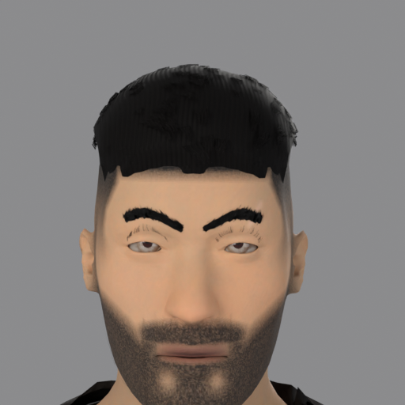
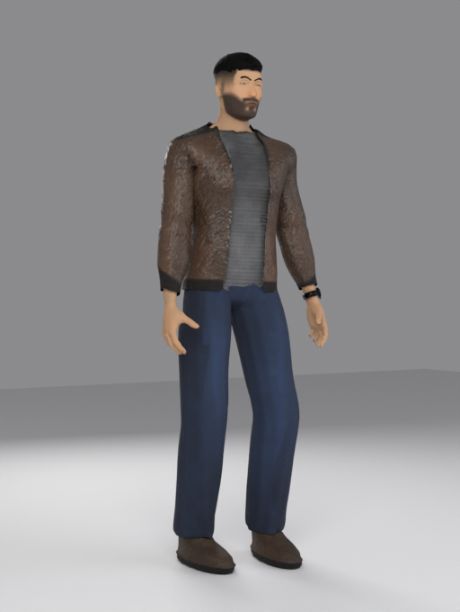
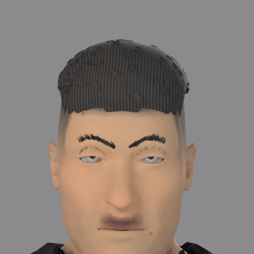
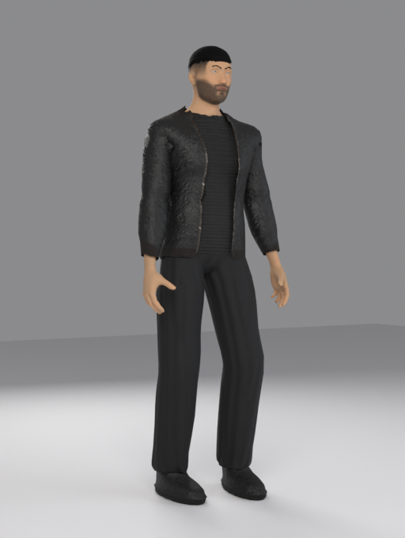

# Bericht: M01 spielbar, NPC-Charaktere im Level, Gesichter repariert

**Branch:** `arena/17d82157-underworld-the-american-dream` · **PR:** #14 → `main`
**Stand:** 2026-11-22 · **Gates:** `RUN_ALL: PASS` (auch auf frischem Worktree), `uwp export-all` PASS (17 Assets)

---

## 1. Was jetzt tatsächlich funktioniert

Die Mission **M01 „Dead Drop"** läuft komplett durch — angenommen, Auto, Fahrt, Paket, Checkpoints, Ausgang, und das auch mit den Fehlschlag-Zuständen:

```
Tests/test_mission.gd → [GPTEST] RESULT: PASS     (Exit 0, ~7 s)
```

Damit das grün wurde, mussten **vier echte Bugs** raus, die vorher niemand gemeldet hat — alle vier waren stille Fehler, die weder Absturz noch Warnung erzeugt haben:

| Symptom | Ursache | Behebung |
|---|---|---|
| Keine Gegner in der Mission | `add_to_group("mission_enemies")` ist **nicht persistent**; `PackedScene.pack()` schreibt die Gruppe nicht in die `.tscn` | `add_to_group(..., true)`, Level neu gebaut — 5 Gegner sind jetzt in `mission_enemies`, je 2 in `wave1`/`wave2` |
| Ziel „Get in the car." nie erfüllbar | Das Objective-Ziel ist ein `Vehicle`; `_area_occupied` castete auf `Area3D` → `null` → immer „nicht besetzt" | Ein `Vehicle` gilt als besetzt, wenn `driver != null` |
| „Package left behind" feuerte nie | Das Paket ist Kind des Trägers → Distanz zum Träger immer ≈ 0 | Gemessen gegen den Spieler (bzw. das Fahrzeug, wenn geladen), plus `_package_ever_held`-Flag, damit der Check nicht vor dem ersten Aufheben feuert |
| Test hing/crashte | `enter()` ist asynchron (Tür-Animation), `exit_vehicle()` existiert gar nicht | Ein-/Aussteigen über echten Exit-Socket, auf `State.DRIVING` warten, `request_exit()` |

**Der Test kann auch fehlschlagen** — sonst wäre er wertlos:
`UW_MISSION_SABOTAGE=1` entfernt ein Checkpoint-Flag → `FAIL (1)`, **Exit 1**.

## 2. Der eigentliche Fund: das Level kannte seine eigenen Szenen nicht

`build_level_calloway.gd` hat allen Knoten instanziierter Sub-Szenen einen Owner gegeben. Godot speichert dann **Vollkopien** statt Instanzen. Konsequenz: `Player.tscn`, `PT_NPC_Gunman.tscn` und `PT_NPC_Civilian.tscn` waren im Level eingefrorene Duplikate — die NPCs standen dort noch als Platzhalter-Kapseln, obwohl die Szenen längst Charaktermodelle hatten. Jede künftige Änderung an diesen Szenen wäre wirkungslos geblieben.

Ownership stoppt jetzt an Sub-Szenen-Wurzeln: **898 Knoten, 132 echte `instance=ExtResource`**.

Die NPCs tragen das echte Modell über `CharacterVisual`. Dafür war eine kleine Erweiterung nötig: NPC-Modelle exportieren die geteilte Animationsbibliothek `A_Humanoid_*`, Jason `A_Jason_*`. `CharacterVisual` hat jetzt `clip_prefix` + `resolve_clip()` und einen generischen Speed/Aim/Crouch/Dead-Treiber, den `NPCController` pro Frame füttert.

Verifiziert im laufenden Level (nicht nur in der Szene):

```
[DV] AI/Civilian_1     model=Model tree=true active=true missing=[] errs=0
[DV] AI/Enemy_Wave1_1  model=Model tree=true active=true missing=[] errs=0
```

## 3. Der Fehler, den nur der Blick gefunden hat

Beim Rendern der Gesichter (verlangte visuelle Prüfung) waren **beide Charaktere halb schwarz** — schwarze Flächen mit korrekt farbigen Streifen, während dieselbe Textur auf der Platte einwandfrei aussah.



Zwei unabhängige Ursachen:

**a) NaN in den Haut-Texturen.** Die neue Lippenmaske rechnete `cos(π/2 · v) ** 0.55`. In float32 ist `cos(π/2)` ≈ −1e-17, und eine negative Basis hoch einem Bruch ist NaN. Bei 1024² traf das **2 837 832 von 3 145 728** Hautwerten; das NaN kroch in Roughness, ORM und Bartmaske, und Cycles rendert NaN als **reines Schwarz**. Genau das waren die schwarzen Flächen.
Behoben: jeder Term wird **vor** der Potenz bei 0 geklemmt, `lip_mask()` ist jetzt eine eigenständige, seiteneffektfreie Funktion mit **10 Unit-Checks** — inklusive eines float32-Regressionsfalls in Texturauflösung, der den alten Fehler reproduziert.

**b) Kaputtes Textur-Packing.** Die gepackte Haut-Textur im `.blend` war 70 087 B groß (Mittelwert 0,048), die Datei auf der Platte 89 033 B (Mittelwert 0,569). `image.save_render()` über die Szene schrieb für diese Maps einen defekten Blob. Maps werden jetzt mit Pillow kodiert und von Blender nur noch geladen und gepackt. Zusätzlich: `pack_np_image()` meldet NaN und neutralisiert sie, statt eine kaputte Map still auszuliefern.

Nebenbefunde, die beim selben Durchgang auffielen und behoben wurden:

- **Brauen** saßen bis 1,5 cm über dem Brauenwulst → dicke schwarze Bögen auf der Stirn.
- **`lip_rgb`** stand im Spec auf oberster Ebene, `pbr_textures` liest aber `skin["lip_rgb"]` → **jeder** Charakter nutzte still die Default-Lippenfarbe.
- **Mund**: ein 26,5 mm breiter Balken als Mundlinie, ein blasses Rechteck aus bartfreier Haut drumherum. Jetzt zwei Lippenloben mit spitz zulaufenden Mundwinkeln, der Bart schneidet mit derselben Maske aus, die Mundlinie ist eine Falte.
- **Pony** von `medium_crop` reichte unter die Brauenlinie (Topfschnitt) bei Marco und der Zivilistin.
- **Haut-Roughness** 0,64 → 0,70 Basis (Foto-Pfad 0,36–0,78 → 0,42–0,84); die alten Werte spiegelten den Studio-Key als Plastikglanz.
- **Face-Render** rahmte 0,19 m bei einem Eye-Anker auf der Brauenlinie — also Stirn und Nase. Jetzt Augenlinie, ganzer Kopf im Bild.

## 4. Renderbilder (Cycles, echte Ausgabe aus diesem Lauf)

| | |
|---|---|
|  |  |
| **SK_Jason** — Bart, Brauen über dem Auge, Narbenkerbe in der linken Braue | **SK_Jason** 3/4 |
|  |  |
| **SK_NPC_Sam** — Skin-Fade, Stoppeln, Lippen jetzt als Lippen lesbar | **SK_NPC_Marco** — Pony über der Braue, nicht mehr darauf |
|  |  |
| **SK_NPC_Civilian_Female** | **SK_NPC_Cartel_A** |

## 5. Charaktere: neu gebaut und exportiert

| Asset | Tris | Meshes | Mats | Budget |
|---|---|---|---|---|
| SK_Jason | 38 840 | 13 | 10 | 40 000 |
| SK_NPC_Sam | 24 871 | 10 | 8 | 25 000 |
| SK_NPC_Marco | 23 104 | 11 | 8 | 25 000 |
| SK_NPC_Cartel_A | 24 577 | 11 | 8 | 25 000 |
| SK_NPC_Cartel_B | 24 747 | 11 | 8 | 25 000 |
| SK_NPC_Civilian_Female | 22 254 | 9 | 7 | 25 000 |
| SK_NPC_Cop_LA | 22 593 | 9 | 7 | 25 000 |

`SK_NPC_Cartel_A/B`, `Civilian_Female`, `Cop_LA` und `Marco` sind in diesem Lauf **zum ersten Mal** gebaut und exportiert worden (Marco brauchte `npc_decimate_body` 0.55, um unter 25 000 zu bleiben).

## 6. Toolchain

- `Tests/lib/godot_errors.sh`: **ein** gemeinsamer Filter für die `fontconfig=no`-ERROR-Zeile, die dieser Sandbox-Godot bei jedem Headless-Start loggt. Alle vier Runner nutzen ihn und fallen weiterhin bei jedem anderen ERROR — mit synthetischem Log verifiziert (`SCRIPT ERROR: Parse Error` kommt durch, die Toolchain-Zeile nicht).
- `Tools/sandbox/make_placeholder_assets.py` und `.cache/placeholder_assets.json` **gelöscht** (Direktive).
- `Docs/ASSET_LICENSES.md`: prozedurale Eigenproduktion dokumentiert (Haut-Maps, Hairline, Hair-Atlas, Brauen-Alternative, Clips) und warum die CC0-Foto-Skins in diesem Sandbox nicht greifen.
- `test_ai.gd` einzeilig-Lambda umformatiert: `gdparse` (gdtoolkit) lehnte sie ab, Godot nicht — jetzt ist `gdparse` über alle `GodotProject/**/*.gd` sauber.

## 7. Gates (alle in diesem Lauf)

| Gate | Ergebnis |
|---|---|
| `Tests/run_all.sh` (Arbeitsbaum) | **PASS** |
| `Tests/run_all.sh` (frischer Worktree, detached HEAD) | **PASS** |
| `./Tools/uwp export-all` | **PASS (exit 0) assets=17** |
| `Tests/test_mission.gd` | **PASS** · Sabotage: **FAIL(1)**, Exit 1 |
| `uwp` Tool-Tests | **PASS**, inkl. 10 `lip_mask`-Checks |
| `gdparse` über `GodotProject/**/*.gd` | sauber (keine Ausgabe) |
| `check_level.gd` | 364 Meshes, 197 093 Vertices |

## 8. Was hier bewusst NICHT behauptet wird

- **Kein „production ready".** Das Referenz-Turnaround (`CA_Jason_Turnaround_v01.jpg`) ist in diesem Sandbox weiterhin ein 131-Byte-LFS-Pointer; der Silhouette-Check bleibt als `WARN CONCEPT_UNAVAILABLE` protokolliert statt zu crashen. Ohne Referenz kein Art-Direction-Sign-off.
- Die Gesichter sind **prozedural** und für 3–10 m Spielabstand gut, aber kein Sculpting-Ersatz. Der Mund ist gemalt, nicht modelliert; in extremer Nahaufnahme bleibt das sichtbar.
- Die CC0-Foto-Skins (`skins01/skins02`) sind in diesem Sandbox nicht erreichbar. Die Haut kommt aus dem prozeduralen Generator (jeder Build loggt `[PBR] procedural skin maps … CC0 photo skin unavailable`). Liegen die Packs in `.cache/uwp_sources/`, greift der Foto-Pfad ohne Codeänderung.
- Die Binärdateien liegen als reguläre Blobs im Repo, nicht via Git LFS (die Dateien im Basisstand waren LFS-Pointer, `git-lfs` ist hier nicht installiert). Vor einem echten Push nach außen sollte das über LFS laufen — das ist eine Entscheidung, die dir gehört, nicht mir.
